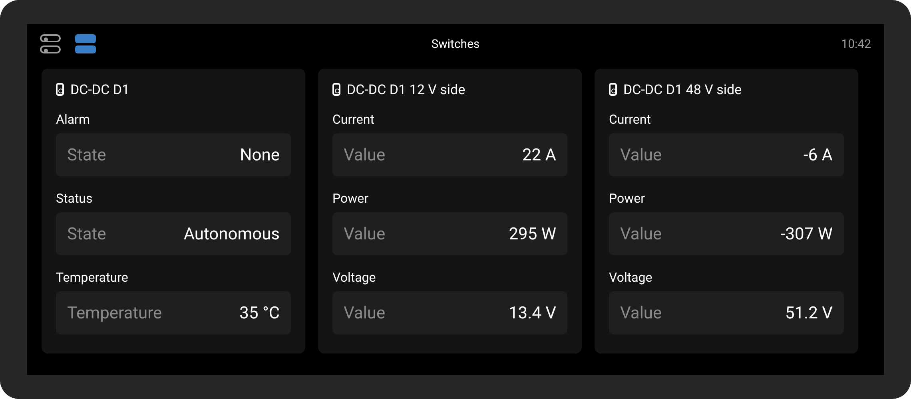
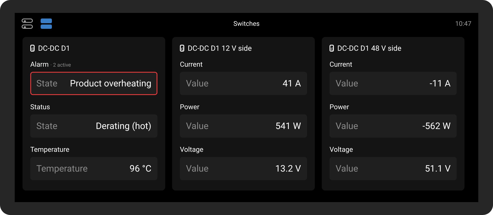
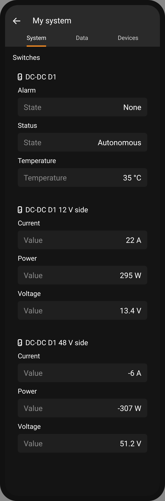
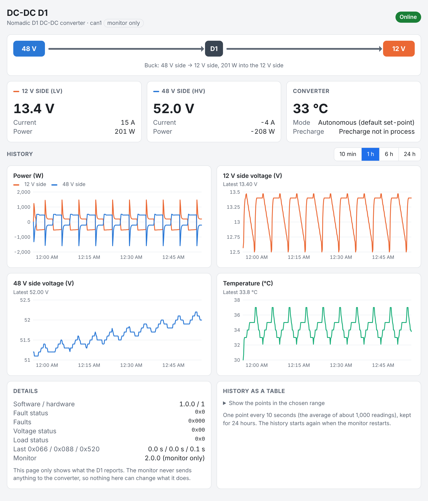
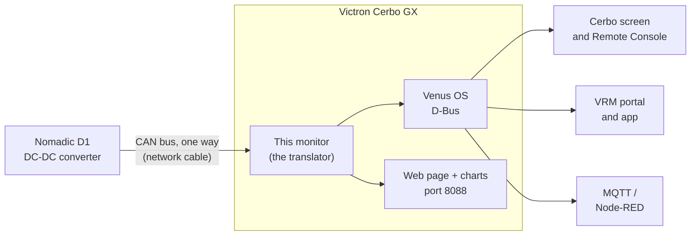

# cerbo-nomadic-d1-monitor

[](https://github.com/CKOCI13/cerbo-nomadic-d1-monitor/actions/workflows/tests.yml)
[](LICENSE)

**Monitor a Nomadic D1 DC-DC converter on a Victron Cerbo GX screen or an Android tablet.** It listens to the D1
and shows its readings on the Cerbo's screen, in the VRM app on your phone, and on a small web page with live
charts that any tablet, phone or laptop on the same network can open.
It never sends the D1 anything, so it can't change what the D1 does.


<sub>What the Cerbo screen shows. The picture is drawn from Victron's own screen design; the real screen may differ slightly.</sub>

> [!NOTE]
> **Monitor only.** This is the monitor-only edition of [cerbo-nomadic-d1](https://github.com/CKOCI13/cerbo-nomadic-d1), which can also control the
> D1 (Off / Buck / Boost). Here the control part has been removed completely: there is no code left that can
> transmit on the CAN bus. The D1 always runs on its
> own built-in logic. It has been thoroughly tested in software (unit tests, a simulated converter, and checks
> against Victron's GUI source code), but not yet on a real D1 and Cerbo. This project isn't made by, or
> affiliated with, Victron Energy or Nomadic.

---

## Contents

- [What is this?](#what-is-this)
- [What it shows](#what-it-shows)
- [What you need](#what-you-need)
- [Try it on your PC in one minute](#try-it-on-your-pc-in-one-minute)
- [Installing it for real](#installing-it-for-real)
- [Why monitor only?](#why-monitor-only)
- [Project status and open questions](#project-status-and-open-questions)
- [How it works](#how-it-works)
- [What's in this repository](#whats-in-this-repository)
- [For developers](#for-developers)
- [FAQ](#faq)
- [Glossary](#glossary)
- [License and credits](#license-and-credits)

---

## What is this?

Many vans, boats and off-grid systems have **two battery systems**: a big **48 V** battery for the heavy loads,
and **12 V** batteries for the vehicle itself. A **DC-DC converter** moves energy between them.

- The **Nomadic D1** is a bidirectional DC-DC converter. It can charge the 12 V side
  from the 48 V side (**buck**), or push energy from the 12 V side up to the 48 V side (**boost**). It decides
  this by itself, based on the 12 V battery's voltage. It also has a **CAN bus** connection for monitoring and control.
- The **[Victron](https://www.victronenergy.com) Cerbo GX** is the "brain and screen" of a Victron power system.
  It shows every battery, charger and inverter, and sends everything to Victron's **VRM** website and app.

The Cerbo doesn't understand the D1. **This project is the translator:** a small program (a "driver")
that runs on the Cerbo, understands the D1's CAN messages, and shows the D1 like any other Victron device.
It only listens.

New to all this? **[How it works, in plain English](docs/how-it-works.md)** explains it with pictures.

## What it shows

- **The D1's readings:** 12 V and 48 V side voltage, current and power, temperature, what it's doing (standby,
  autonomous, derating…) and every alarm and fault it reports, in plain words.
- **On the Cerbo's screen:** three cards in the switch pane: the converter (alarm, status, temperature), its
  12 V side and its 48 V side. The D1 also appears in the device list as a DC-DC converter.
- **Everywhere Victron does:** Remote Console, the VRM portal and app, MQTT and Node-RED.
- **Its own web page** at `http://<cerbo-address>:8088`, for any tablet (Android or iPad), phone or laptop on the
  same network, with live
  values, which way the energy is flowing, and charts of the last 24 hours.
- **Help getting started:** a pretend converter for trying it out, and a "find the converter" check.

| Cerbo screen | When there's a problem | VRM app |
|---|---|---|
|  |  |  |

## What you need

| | |
|---|---|
| **Converter** | A Nomadic D1 bidirectional DC-DC converter |
| **Victron device** | A Cerbo GX (or another Victron GX device) running **Venus OS v3.80 or newer** |
| **Cable** | A normal network (Ethernet) patch cable, which you adapt. The [Installation Guide](docs/installation-guide.pdf) shows how |
| **Terminators** | A 120 Ω resistor at the D1 end, plus the Victron terminator plug that comes with the Cerbo |
| **A computer** | Windows, for the [`Cerbo Setup.bat`](Cerbo%20Setup.bat) helper. On Mac or Linux, use the commands in the [driver reference](dbus-nomadic-dcdc/README.md) |

You don't need to install anything on the Cerbo yourself, and you don't need programming knowledge:
the helper copies and installs the monitor for you.

## Try it on your PC in one minute

You can see the driver working without a Cerbo or a converter. It includes a **pretend D1**.
You need [Python 3](https://www.python.org/downloads/) installed.

```bash
git clone https://github.com/CKOCI13/cerbo-nomadic-d1-monitor.git
cd cerbo-nomadic-d1-monitor
python dbus-nomadic-dcdc/dbus-nomadic-dcdc.py --simulate --no-dbus
```

Then open **<http://localhost:8089>** in your browser. The pretend 12 V battery slowly drains, the pretend D1
fills it back up to about 13.4 V, and every three minutes a pretend alternator makes it boost the other way. The
charts fill in as it runs (one point every 10 seconds). Press **Ctrl+C** to stop.
(No Git? Click the green **Code** button on GitHub, then **Download ZIP**, unzip it, and run the last line
inside the unzipped folder. On Mac or Linux, type `python3` instead of `python`.)



## Installing it for real

Follow the **[Installation Guide (PDF)](docs/installation-guide.pdf)**. It has pictures for every step. In short:

1. **Make the cable.** Cut one end off a network cable and connect three of its wires to the D1.
2. **Set up the Cerbo.** Check the firmware version, choose the CAN port and its speed, and allow your PC to connect.
3. **Connect everything.**
4. **Run [`Cerbo Setup.bat`](Cerbo%20Setup.bat)** on your Windows PC. It finds the converter, lets you edit the
   settings, and installs the monitor with a menu: no commands to type.
5. **Check it** with the **[Safe Test Plan (PDF)](docs/safe-test-plan.pdf)**: four short stages, none of which can
   change what the D1 does.

After installing, the monitor starts by itself whenever the Cerbo starts, including after firmware updates.

**Switching from [cerbo-nomadic-d1](https://github.com/CKOCI13/cerbo-nomadic-d1) (the control version)?** Put it in **Automatic** first, so it's already sending nothing,
then install. See the note in the Installation Guide, step 5.

## Why monitor only?

Nomadic's documents don't say what the D1 does when the commands from a controller stop: if the Cerbo restarts
or the cable comes loose, does it go back to its own logic, or keep doing the last thing it was told? Until that's
known, and tested on real hardware, the safest Cerbo is one that can't command the D1 at all. So this version:

- **has no transmit code:** the CAN socket is opened for receiving only, the control-message encoder is gone, and an
  automated test fails if anyone adds a way to send;
- **has nothing writable** on the Cerbo, in VRM or over MQTT except the names, cards and visibility of the screen items;
- **serves a read-only web page:** any request other than reading gets `405 Method Not Allowed`.

The D1 keeps protecting itself, as always: over-voltage, over-current, short circuits and overheating.

## Project status and open questions

**Works and is tested in software:**

- The CAN decoding, checked against frames worked out by hand from Nomadic's specification.
- The Cerbo screen and VRM items, checked against the rules in Victron's GUI source code.
- The web page, its API and history, the "find the converter" scan, and the pretend D1.
- That nothing in the monitor can transmit.

Every change is tested automatically by GitHub ([the tests badge](#cerbo-nomadic-d1-monitor) above).

**Not yet tried on real hardware**, and **not yet known** (Nomadic's documents don't say):

1. Does the D1 send its readings even when it isn't receiving commands? The monitor assumes it does; the
   "find the converter" step shows it straight away.
2. Which direction counts as positive current in the D1's readings. The Safe Test Plan checks this with a clamp meter.

If you try it, please share what you find in an [issue](../../issues).

## How it works



- **Listening:** the D1 sends three kinds of CAN message: measurements 100 times a second, status 20 times a
  second, and its version 10 times a second. The monitor decodes them and publishes them on Venus OS's internal
  message bus (D-Bus). Everything else in the Cerbo (the screen, VRM, MQTT) reads them from there.
- **Nothing goes back:** the monitor never sends anything on the CAN bus.
- **On the screen:** the monitor uses Victron's standard "switch" interface (the same one used by GX relays and
  smart switches), so its readings appear as cards in the Cerbo's switch pane and in VRM without changing any
  Victron software.
- **History:** every 10 seconds it averages the last 1,000 readings into one point and keeps 24 hours of them in
  memory, for the web page's charts.

The **[developer guide](docs/developer-guide.md)** explains the design in detail.

## What's in this repository

```
cerbo-nomadic-d1-monitor/
├── README.md                 ← you are here
├── Cerbo Setup.bat           ← Windows helper: copies, tests and installs the monitor on the Cerbo
├── dbus-nomadic-dcdc/        ← the monitor itself: this whole folder goes onto the Cerbo
│   ├── dbus-nomadic-dcdc.py      the monitor program
│   ├── nomadic_can.py            decodes the D1's CAN messages
│   ├── config.ini                settings (edit this)
│   ├── webui.html                the built-in web page with charts
│   ├── install.sh, uninstall.sh  add / remove it as a Cerbo service
│   ├── service/                  start-up scripts used by Venus OS
│   └── README.md                 technical reference: every setting, D-Bus path and command
├── docs/
│   ├── installation-guide.pdf    step-by-step guide with pictures
│   ├── safe-test-plan.pdf        printable checklist for bringing it into service
│   ├── how-it-works.md           plain-English explanation with pictures
│   ├── developer-guide.md        how the code is built
│   ├── images/                   pictures used by the docs
│   └── src/                      sources of the pictures and PDFs, and the script that builds them
├── tests/                    ← automated tests (run on any PC)
├── .github/workflows/        ← makes GitHub run the tests on every change
├── CHANGELOG.md              ← what changed in each version
└── LICENSE                   ← MIT No Attribution: use it for anything
```

## For developers

- The driver is plain **Python 3** using only the standard library, plus the libraries already on every
  Victron GX device (`dbus-python`, `PyGObject` and Victron's `velib_python`).
- Run the tests on any computer: `python -m unittest discover -s tests -v`. See [tests/README.md](tests/README.md).
- The **[developer guide](docs/developer-guide.md)** covers the architecture, threads, CAN messages, D-Bus
  mapping, the Cerbo screen cards, web API and history, simulation, how the pictures and PDFs are built, and how to
  make changes safely.
- The **[driver reference](dbus-nomadic-dcdc/README.md)** lists every setting, D-Bus path and manual command.

Contributions are welcome: open an issue or a pull request.

## FAQ

**Will installing this change how my D1 behaves?**
No. The monitor only listens. It has no code that can send the D1 anything.

**Can I control the D1 from the Cerbo, then?**
Not with this one. The original project, [cerbo-nomadic-d1](https://github.com/CKOCI13/cerbo-nomadic-d1), can. Control was left out here until it's
known how the D1 behaves when commands stop. The two use the same folder and service name on the Cerbo, so only
one of them is installed at a time: installing one replaces the other.

**Do I need to know how to program?**
No. The [Installation Guide](docs/installation-guide.pdf) and the `Cerbo Setup.bat` menu cover everything.
You will make a simple cable and press some buttons on the Cerbo's screen.

**Does it work with Victron's VRM app?**
Yes. The readings appear in the **Switches** section of the VRM portal and app.

**Why does one side show a minus sign?**
Plus means energy going into that battery, minus means coming out. In buck the 48 V side is minus; in boost the
12 V side is. See [Reading the numbers](docs/how-it-works.md#reading-the-numbers).

**Why are the charts empty after a restart?**
The history is kept in memory, so it starts again whenever the monitor or the Cerbo restarts. For long-term
history, use VRM.

**How do I remove it?**
Run `Cerbo Setup.bat` and choose **8**. The D1 isn't affected.

**Where are Nomadic's documents?**
They're Nomadic's copyrighted material, so they aren't included here. Ask Nomadic for the *D1 Bidirectional
DC-DC Converter Manual* and the *DC-DC Converter CAN Interface Control Document* (NI-TLN-CONTROLS-DCDCCAN-R1).

## Glossary

| Term | Meaning |
|---|---|
| **Buck** | Converting down: the 48 V side charges the 12 V side |
| **Boost** | Converting up: the 12 V side pushes energy to the 48 V side |
| **CAN bus** | A two-wire network that vehicles and batteries use to exchange short messages |
| **CAN-H / CAN-L** | The two CAN wires ("high" and "low"), twisted together |
| **Termination** | A 120 Ω resistor at each end of a CAN bus, which stops messages reflecting back |
| **KL30 / KL15** | Automotive names for the D1's permanent 12 V supply (KL30) and its "wake-up" / enable input (KL15) |
| **Cerbo GX / GX device** | Victron's system monitor and controller |
| **Venus OS** | The Linux-based software that runs on Victron GX devices |
| **D-Bus** | The internal message system Venus OS uses to share values between programs |
| **VRM** | Victron Remote Management: Victron's website and phone app for remote monitoring |
| **Remote Console** | The Cerbo's screen, shown in a web browser or in VRM |
| **Switch pane** | The page on the Cerbo screen that shows switches, sliders and readings from devices, as cards |
| **Monitor** | A program that only watches and reports: it never changes anything |
| **Driver** | A program that lets one device (the Cerbo) understand another (the D1) |

## License and credits

- **License:** [MIT No Attribution (MIT-0)](LICENSE). You may use, copy, change and share this for any purpose,
  with no need to credit anyone. It comes with **no warranty**.
- **Trademarks:** Victron Energy, Cerbo GX, Venus OS and VRM are trademarks of Victron Energy B.V. Nomadic and
  D1 belong to their owner. This project isn't affiliated with or endorsed by either company.
- **Built on:** Victron's open-source [Venus OS D-Bus API](https://github.com/victronenergy/venus/wiki/dbus),
  [velib_python](https://github.com/victronenergy/velib_python) and the [gui-v2](https://github.com/victronenergy/gui-v2)
  design, and Victron's [VE.Can cable pinout](https://www.victronenergy.com/live/battery_compatibility:can-bus_bms-cable).
