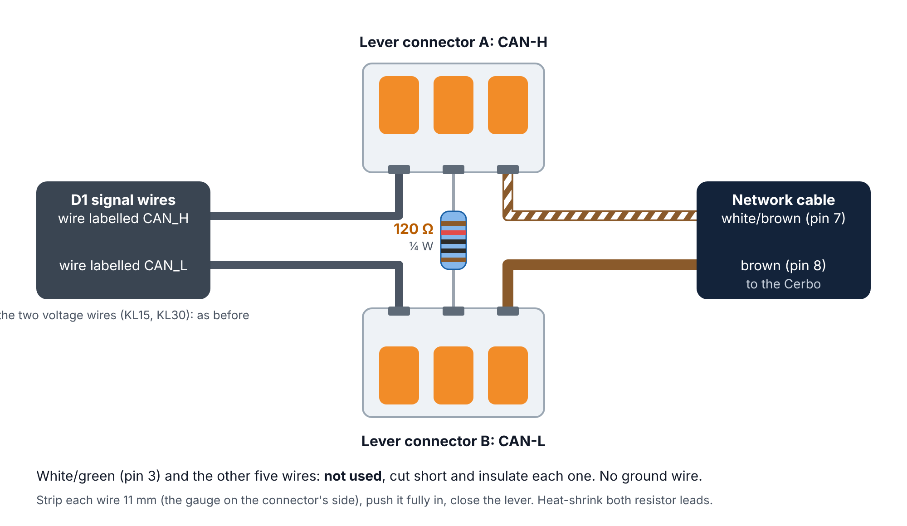

# Nomadic D1 DC-DC converter: monitor for a Victron Cerbo GX

This monitor runs on a Victron GX device (Cerbo GX, Ekrano GX or another device running Venus OS). It decodes the
three messages the D1 sends, as defined in `NI-TLN-CONTROLS-DCDCCAN-R1` (DCDC_PARAMETER 0x066,
DCDC_ELECTRIC_VALUE 0x088, DCDC_VERSION 0x520), and shows:

* LV/HV voltage, current and power, temperature, operating mode, precharge status, firmware and hardware version,
  and every fault, voltage, load and derating bit, decoded into plain text
* 24 hours of history, as charts on its web page

**Monitor only.** It never transmits on CAN: the socket is receive-only, there is no encoder for the control
message (EMS_DCDC_CTRL 0x018), and nothing on D-Bus or the web page accepts a command. The D1 always runs on its
own built-in logic.

You can see it on:

* the **GX screen / Remote Console**: three cards in the switch pane, and the device page
* **VRM**: the Switches panel on the VRM dashboard, and the Switches widget in the VRM app
* a **web page** with charts at `http://<GX-IP>:8088`
* **D-Bus, MQTT and Node-RED**, where every value is a path (listed below)

> This is the **technical reference** for the driver folder. New here? Start with the
> [project README](../README.md). For step-by-step instructions with pictures, see the
> [Installation Guide](../docs/installation-guide.pdf). The [`Cerbo Setup.bat`](../Cerbo%20Setup.bat) helper in the
> project folder does all of the steps below from Windows, with no typing of commands.

## 1. Wiring

| D1 wire (labelled, from its signal plug) | Connect to |
|---|---|
| CAN_H | GX RJ45 **pin 7** (white/brown), in lever connector A with one resistor leg |
| CAN_L | GX RJ45 **pin 8** (brown), in lever connector B with the other resistor leg |
| KL15 (enable) | 12 V enable, ≥ 8 V = on: switched (ignition, relay) or linked to KL30 |
| KL30 | Permanent **fused** 12 V (9–16 V, up to 2 A) |
| (no CAN ground) | RJ45 pin 3 (white/green) is not used |



* **The D1 needs KL30 and KL15** (manual Rev D). Without them its controller is off, and it neither converts
  nor talks on CAN.
* **No CAN ground wire.** CAN is differential, and the GX and the D1 already share the system negative through
  their power wiring. The GX's VE.Can 2 port is not isolated, so a thin CAN-ground wire would run in parallel with
  the main negative cables. Leave RJ45 pin 3 unconnected. Check once with the D1 working hard: Cerbo negative to
  D1 GND should be a few tenths of a volt; over about 1 V means a poor negative connection.
* **Joining:** two 3-way lever connectors (e.g. WAGO 221-413, 24–12 AWG; strip 11 mm). A: D1 CAN_H + white/brown +
  resistor leg. B: D1 CAN_L + brown + other resistor leg. Insulate the resistor legs.
* Victron RJ45 pinout: **pin 7 CAN-H, pin 8 CAN-L** (Victron's VE.Can to CAN-bus BMS cable manual). Leave the
  other pins unconnected.
* The bus needs exactly **two 120 Ω terminators**: a VE.Can terminator in the GX port's second socket, and
  a **120 Ω resistor between CAN_H and CAN_L at the D1** (the D1 has no built-in terminator). With everything
  connected and off, CAN-H to CAN-L should measure about 60 Ω.
* Use a port that has nothing else on it, normally the Cerbo's **second CAN port** (usually `can1`; `--scan`,
  below, lists the real names and shows which one the converter is on):
  * **Cerbo GX MK2** (ports labeled VE.Can 1 and VE.Can 2): use **VE.Can 2**. It is not isolated: its CAN GND
    is the Cerbo's own negative, which is why no separate CAN ground wire is run.
  * **Original Cerbo GX** (second port labeled BMS-Can): BMS-Can only runs at **500 kbit/s** (see section 2).

## 2. Bitrate and port profile

The D1 talks at either 250 or 500 kbit/s, and the GX port must match it. On the GX, go to
**Settings → Connectivity → (your CAN port) → CAN-bus profile** and choose **"VE.Can (250 kbit/s)"** (the default).
If `--scan` reports bus errors but no frames, the D1 is at the other speed: switch to
**"CAN-bus BMS LV (500 kbit/s)"** (called "CAN-bus BMS (500 kbit/s)" on older firmware).

Victron's own services on the port use 29-bit (extended) CAN IDs; the D1 uses 11-bit (standard) IDs, and the
driver only listens for those, so they share the port without trouble.

**"Up, but no services"** (250 or 500 kbit/s) would bring the port up with no Victron services at all, but the
Cerbo screen (gui-v2, Venus OS v3.80+) hides it and won't let you choose it. If you want it anyway, set it over
SSH, using the port name from `--scan` (for example `vecan1` or `can1`); 5 = 250 kbit/s, 8 = 500 kbit/s:

```sh
dbus -y com.victronenergy.settings /Settings/Canbus/vecan1/Profile SetValue 5
```

On a Cerbo GX MK2 the second port's menu is **VE.Can port 2** (some firmware still calls it BMS-Can port).
On an **original Cerbo GX**, the BMS-Can port is fixed: its only choices are
**CAN-bus BMS (500 kbit/s)** and disabled. Leave it on CAN-bus BMS (500 kbit/s). It works only if the D1 talks
at 500 kbit/s; if `--scan` reports bus errors there, the D1 is at 250 kbit/s, so use the VE.Can port instead.

## 3. Root access

1. Go to **Settings → General → Access & Security → Access level** and choose **User & Installer**
   (password `ZZZ`).
2. Still on the Access & Security page, pull the list down and hold it for 5 seconds (on Remote Console with a
   keyboard: hold the right-arrow key). The access level changes to **Superuser**.
3. Set a **Root password** (8 characters or more) and switch on **Enable SSH on LAN**.

## 4. Copy the files

From PowerShell in the folder that contains `dbus-nomadic-dcdc`:

```
scp -O -r dbus-nomadic-dcdc root@<GX-IP>:/data/
```

(Leave out `-O` with OpenSSH older than 9.0.) Everything under `/data` survives firmware updates.

### Or: install from a USB stick or SD card

Download `venus-data-nomadic-d1-monitor.tar.gz` from the [latest release](https://github.com/CKOCI13/cerbo-nomadic-d1-monitor/releases/latest) (or edit `config.ini` and build your own with
`Cerbo Setup.bat` option U or `sh make-usb-installer.sh`), copy it to the top folder of a FAT32 USB stick or SD card,
put it in the GX and restart. Modifications must be enabled (*Settings › General › Modification checks*, the default).
Venus OS unpacks it into `/data` and runs its `rc/post-hook.sh`, which runs `install.sh`: steps 4 and 7 are done
for you, with no SSH. The hook then renames the file on the stick to `...tar.gz.installed`, so it installs only once. See the [project README](../README.md#installing-from-a-usb-stick-or-sd-card-no-network-needed).

## 5. Find the converter and check communication

```
ssh root@<GX-IP>
python3 /data/dbus-nomadic-dcdc/dbus-nomadic-dcdc.py --scan       # which port, its speed, bus errors, Venus OS version
python3 /data/dbus-nomadic-dcdc/dbus-nomadic-dcdc.py --monitor    # live readings; Ctrl+C to stop
```

`--monitor` should show about `0x066=20/s 0x088=100/s 0x520=10/s`. If nothing is heard, check the cable,
the termination and the bitrate (`ip -details link show can1`).

## 6. Configure

Edit `config.ini`:

* `interface`: leave it on `auto` (the driver uses the CAN port it hears the D1 on), or force the port that
  `--scan` reported. Names differ between models: `can0`/`can1`, or `vecan0`/`vecan1` on the Cerbo GX MK2
* `custom_name`: the name on the GX and in VRM (default "DC-DC D1")
* `password`: optional, for the web page
* `temperature_unit`: `auto` (the Cerbo's own setting), `fahrenheit` or `celsius`, for the web page
* `switch_pane = no` if you don't want the cards on the GX screen and in VRM
* `[temperature]`: `warning` (default 100 °C / 212 °F) and `alarm` (105 °C / 221 °F), in °C; `sensor = no` to
  leave out the temperature sensor, `sensor_instance` (default 71) for its device instance

## 7. Install as a service

```
sh /data/dbus-nomadic-dcdc/install.sh
tail -F /var/log/dbus-nomadic-dcdc/current | tai64nlocal
```

The monitor starts within a few seconds and restarts by itself if it ever stops. `install.sh` adds itself
to `/data/rc.local`, so the monitor also comes back after reboots and firmware updates.

After you edit `config.ini`, restart the monitor with `svc -t /service/dbus-nomadic-dcdc`.

## 8. Use it

### GX screen, Remote Console and VRM

This needs **Venus OS v3.80 or newer** on the GX (check under Settings → General → Firmware). The monitor publishes its
readings through Victron's standard switch API, so they appear wherever Victron shows switches:

* **GX touchscreen and Remote Console** (including the Console tab in VRM): open the **switch pane**.
* **Settings → Devices → DC-DC D1**: the device page lists every item and lets you rename it, move it to another card,
  or hide it. Your changes are kept in `ui.json`.
* **VRM portal**: the **Switches** panel on the dashboard.
* **VRM app** (Android/iOS): the **Switches** widget.

Three cards appear. All items are read-only.

| Card | Item | Shows |
|---|---|---|
| **DC-DC D1** | Alarm | The most serious active alarm, or None. The tile turns red ("Fault") on a fault, and "N active" appears when there are several |
| | Status | The converter's operating mode (Standby, Autonomous, Buck, Boost, Derating…), or "No communication" |
| | Temperature | Power board temperature, in your GX temperature unit (°F or °C, see below) |
| | Precharge status *(hidden)* | In progress / Not active. Hidden because the D1 manual doesn't use precharge; show it from the device page |
| **DC-DC D1 12 V side** | Current, Power, Voltage | LV side. Power = V × A |
| **DC-DC D1 48 V side** | Current, Power, Voltage | HV side |

Currents and powers keep the sign the D1 reports. As far as is known, + means into that side's battery (so in buck
the 12 V side is + and the 48 V side −); the spec doesn't say, so check once with a clamp meter.

For **VRM**, the GX has to be online. Set `switch_pane = no` in `config.ini` if you don't want any of this on the
GX or in VRM.

### Web page

Open `http://<GX-IP>:8088`. It shows live values, the direction of the energy flow, alarms, the decoded status
bits, and charts (power, 12 V voltage, 48 V voltage, temperature) over 10 minutes to 24 hours. Point at a chart
to read the values at that moment. Set `password` in `config.ini` to require a login; without one, anyone on your
network can see the readings (nobody can change anything). The page is read-only: requests other than `GET`
are refused with `405`.

API: `GET /api/status` (live values) and `GET /api/history?minutes=60` (one point every 10 s; fields
`time, lv_voltage, lv_current, lv_power, hv_voltage, hv_current, hv_power, temperature`). The history is kept in
memory and starts again when the monitor restarts.

### As an alternator (default) or a DC-DC converter

The monitor also registers as a standard Victron device named `custom_name` (default "DC-DC D1"), of the kind
`service_class` sets:

| `service_class` | Output (`Dc/0`) | Input (`Dc/In`) | On the GX |
|---|---|---|---|
| `alternator` (default) | HV (48 V) side | LV (12 V) side | Device list, an **Alternator tile on the Overview**, and counted in the GX's DC Loads / DC system figure |
| `dcdc` | LV (12 V) side | HV (48 V) side | Device list only. Victron's `dbus-systemcalc-py` leaves DC-DC converters out of its sums, so DC Loads is off by the converter's power while it runs |

`Dc/0/Current` and `Power` are **+ while current flows into that battery**. `Dc/In/I` and `P` are **+ while
current flows from that side into the converter**. Both turn negative while the converter runs the other way.

**Direction.** A real D1 reported both currents as positive while boosting, so the monitor takes the direction
from its operating mode: in boost (0x3) current leaves the 12 V side and enters the 48 V side, in buck (0x4) the
other way round. In every other mode it keeps the sign the D1 sends. The switch pane, web page and history use
the same convention (+ = into that battery).

**DVCC.** As an alternator, the GX's DVCC sees the D1 as a charger, but it only writes to `/Link/*` paths a device
publishes, and this one publishes none, so nothing is ever sent (and the D1 has no settings the GX could change).
With a Victron Multi or Quattro under DVCC, the D1's charge current is subtracted from what the Multi may charge,
as for any alternator.

There's no on/off switch on its page.

### Temperature

The D1 reports its **internal power-board** temperature. From the D1 manual (Rev D, section IV.B): full output up
to 105 °C (221 °F), current derated in a straight line from 100 % to 0 % between 105 and 120 °C (221–248 °F),
conversion stopped with a fault above 120 °C (248 °F). A D1 boosting about 1.7 kW read 82 °C (180 °F) in the first
real test, so readings around there are normal.

Where it appears:

| Where | How |
|---|---|
| Overview, Alternator tile | `/Dc/0/Temperature`, top right of the tile (`service_class = alternator` only) |
| Device page | "Alternator temperature" (Victron's wording). As `dcdc` the page would say "Battery temperature", so it isn't published there |
| Levels › Environment, device list, Brief page centre, relay temperature control, VRM | A second service, `com.victronenergy.temperature.nomadic_<interface>` (device instance `sensor_instance`, default 71), named `custom_name`, type **Water heater**: the only GX gauge scale (0–100 °C, 32–212 °F) that takes in a working D1; Generic stops at 60 °C (140 °F). The type can be changed on its page and is kept |
| Switch pane, VRM Switches | The Temperature item; the Alarm item names the monitor's warning or alarm after the D1's own alarms |
| Web page | The reading, OK / Warning / Alarm, the message in Active alarms, and the chart |

**Warning and alarm.** The D1 doesn't report anything before it derates, so the monitor raises its own levels from
`[temperature] warning` and `alarm` (°C, defaults 100 and 105): `/Alarms/HighTemperature` is 1 (warning) or 2
(alarm). For an alternator the GX's notification system turns that into a **High Temperature** notification on the
screen and in VRM; Victron has no such alarm for `dcdc`, so there only the switch pane and the web page show it.
Each level clears 3 °C below where it came on. No reading (converter silent) clears it.

**Fahrenheit or Celsius:** the Cerbo screen, VRM and the web page all show the temperature in the unit set on the
Cerbo, at **Settings → General → Display & Appearance → Data units → Temperature**. Choose **Fahrenheit** there for
°F. `temperature_unit` in the `[web]` part of `config.ini` can force the web page to `fahrenheit` or `celsius`
instead; on a PC (`--simulate` or `--no-dbus`) the page shows °F.

### D-Bus / MQTT / Node-RED

Service: `com.victronenergy.<service_class>.nomadic_<interface>`, so `com.victronenergy.alternator.nomadic_auto` with the defaults (MQTT: `N/<portal-id>/alternator/<device_instance>/...`).
Every value path is read-only.

| Path | Meaning |
|---|---|
| `/Dc/0/Voltage`, `/Dc/0/Current`, `/Dc/0/Power` | Output side (V, A, W): HV side as an alternator, LV side as `dcdc`. + = into that battery |
| `/Dc/In/V`, `/Dc/In/I`, `/Dc/In/P` | Input side (V, A, W): the other side. + = from that side into the converter |
| `/Dc/0/Temperature` | Board temperature (°C; the GX converts it to your unit). Alternator only |
| `/Alarms/HighTemperature` | 0 ok, 1 warning, 2 alarm (from `[temperature]`) |
| `/State` | 0 off, 2 fault, 11 regulating, 245 starting |
| `/Nomadic/Online` | 1 while frames are arriving |
| `/Nomadic/OperatingMode`, `/Nomadic/OperatingModeText` | Raw DCDC_OPERATING_MODE and its text |
| `/Nomadic/PrechargeStatus`, `/Nomadic/PrechargeStatusText` | Raw DCDC_PRECH_STATUS and its text |
| `/Nomadic/FaultStatus`, `/Nomadic/Faults`, `/Nomadic/VoltageStatus`, `/Nomadic/LoadStatus` | Raw bitfields |
| `/Nomadic/Alarms` | All active bits as text, `;`-separated |
| `/Nomadic/SoftwareVersion` | BCD software version, e.g. `1.2.3` |
| temperature service: `/Temperature`, `/TemperatureType` | Board temperature (°C) and sensor type (5 = water heater; the only writable path) |
| `/GenericInput/<item>/...` | The switch-pane items above ([Victron switch API](https://github.com/victronenergy/venus/wiki/dbus#switch)). Only their `/Settings/CustomName`, `/Settings/Group` and `/Settings/ShowUIInput` are writable |

## Trying it without a converter

`dbus-nomadic-dcdc.py --simulate` (Cerbo Setup option 9) runs the monitor against a pretend D1 and never opens a
CAN socket. It registers separately (`com.victronenergy.<service_class>.nomadic_sim`, device instances + 1, name
"… (SIMULATED)", web page on port 8089, `ui-sim.json`), so it can run beside a real installation. The pretend D1
follows the manual's automatic logic, with a 12 V side that alternates between a load and a charging source, so
buck, standby and boost all show up within a few minutes. Add `--no-dbus` to run it on any PC.

## Upgrading from version 1

Version 1 ([cerbo-nomadic-d1](https://github.com/CKOCI13/cerbo-nomadic-d1)) can control the D1. Installing version 2 over it (same folder, same service) replaces it. If version 1
was in Off, Buck or Boost, its command frames stop when it's replaced, and it isn't known whether the D1 then goes
back to its own logic. So first set version 1 to **Automatic** (it then sends nothing), check the D1 behaves as it
does on its own, and only then install version 2. If the D1 ever seems stuck, switching KL15 off and on restarts its
controller (if KL15 is joined to KL30, as on the LTV1, pull that wire's fuse for a few seconds). The old `state.json` is no longer used and can be deleted.

## Points to confirm with Nomadic

1. **DCDC_FAULT_STATUS** is 3 bits wide, but its error value is listed as 0x08, which doesn't fit in 3 bits.
2. **SW_Version** is 12 bits wide, but its range is given as 0x00000–0xFFFFFF (24 bits). The monitor decodes it
   as 3 BCD digits.
3. **Current sign:** the spec doesn't say which direction is positive for DCDC_I14 and DCDC_IHV. Values are
   shown exactly as the converter reports them.
4. Whether the D1 sends its status frames even when it isn't receiving EMS_DCDC_CTRL (the monitor assumes it does).

## Files

| File | Purpose |
|---|---|
| `dbus-nomadic-dcdc.py` | The monitor: CAN input, history, D-Bus service, web server, `--scan`, `--monitor` and `--simulate` |
| `nomadic_can.py` | Decoder for the D1's three messages (no dependencies) |
| `webui.html` | The web page |
| `config.ini` | Settings |
| `ui.json` | Created at run time: your switch-pane names, cards and visibility (`ui-sim.json` for the simulation) |
| `install.sh` / `uninstall.sh` | Add / remove the service |
| `service/` | daemontools run scripts |

The tests are kept outside this folder, in [`../tests`](../tests), so they aren't copied onto the Cerbo.

## Uninstall

```
sh /data/dbus-nomadic-dcdc/uninstall.sh
rm -r /data/dbus-nomadic-dcdc
```
