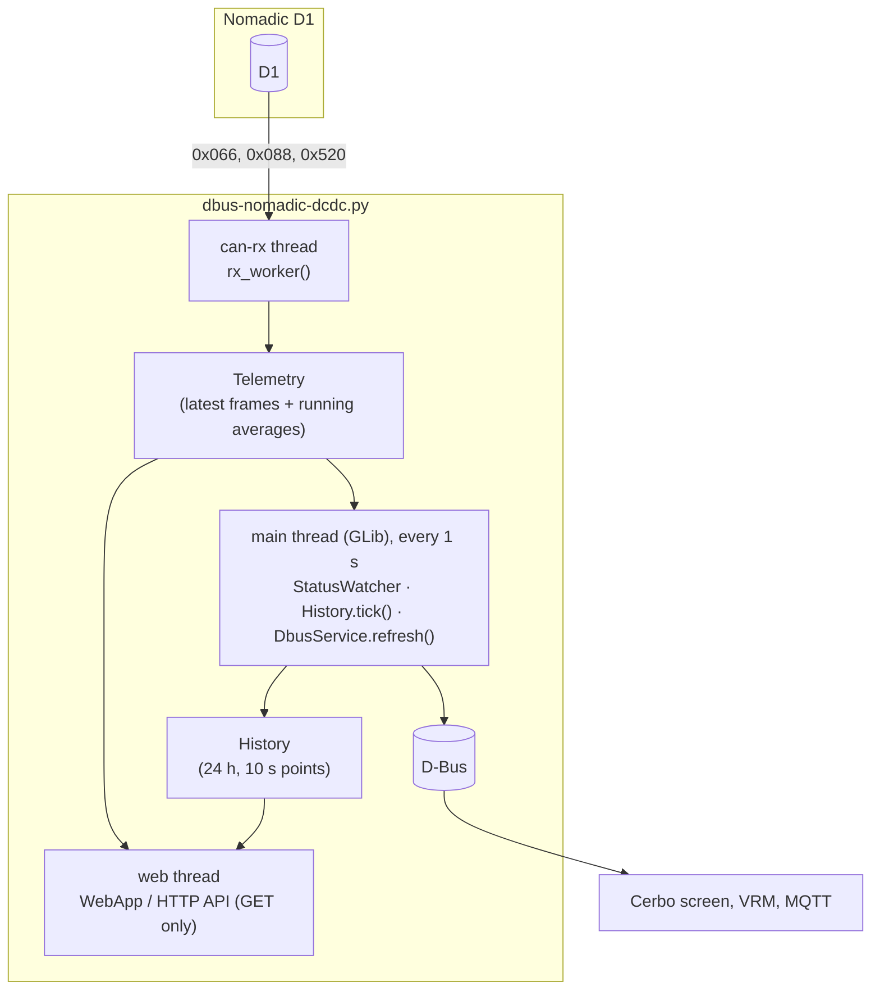

# Developer guide

How the monitor is built, why it's built that way, and how to change it safely. For installing and using it,
see the [project README](../README.md). For every setting and D-Bus path, see the
[driver reference](../dbus-nomadic-dcdc/README.md).

---

## Contents

- [Big picture](#big-picture)
- [Monitor only, by construction](#monitor-only-by-construction)
- [Files](#files)
- [Threads and data flow](#threads-and-data-flow)
- [The CAN messages](#the-can-messages)
- [What appears on the Cerbo and in VRM (D-Bus)](#what-appears-on-the-cerbo-and-in-vrm-d-bus)
- [History](#history)
- [The web page and its API](#the-web-page-and-its-api)
- [Simulation](#simulation)
- [Finding the converter (scan)](#finding-the-converter-scan)
- [Installation on the Cerbo](#installation-on-the-cerbo)
- [Pictures and PDFs](#pictures-and-pdfs)
- [Tests](#tests)
- [Making a change](#making-a-change)
- [Open questions and ideas](#open-questions-and-ideas)

---

## Big picture

The monitor is one Python program, [`dbus-nomadic-dcdc.py`](../dbus-nomadic-dcdc/dbus-nomadic-dcdc.py), that runs
as a service on a Victron GX device (Venus OS, which is Linux). It:

1. **Reads** the D1's CAN messages from a SocketCAN interface (`can0` / `can1` on a Cerbo GX: `can1` is the second port, VE.Can 2 on the MK2 or the 500 kbit/s-only
   BMS-Can on the original).
2. **Publishes** the decoded values on D-Bus, where the Cerbo's GUI, VRM, MQTT and Node-RED pick them up. On the
   Cerbo screen they appear as three cards in the switch pane.
3. **Keeps a history:** one averaged point every 10 seconds, 24 hours of them, in memory.
4. **Serves** a small read-only web page with live values and charts, and a JSON API.

It uses only the Python standard library, plus what every GX device already has: `dbus-python`, `PyGObject`
(GLib) and Victron's [`velib_python`](https://github.com/victronenergy/velib_python). Nothing needs installing.



## Monitor only, by construction

The original project, [cerbo-nomadic-d1](https://github.com/CKOCI13/cerbo-nomadic-d1), can also command the D1. This edition (version 2) leaves that out, because nobody knows yet what the D1 does when the
command frames stop (see [open questions](#open-questions-and-ideas)). "Monitor only" isn't a setting; it's the
shape of the code, and the tests hold it there:

| Layer | What makes it read-only | Test |
|---|---|---|
| CAN codec | [`nomadic_can.py`](../dbus-nomadic-dcdc/nomadic_can.py) only decodes the D1's three messages. The control message (`EMS_DCDC_CTRL`, 0x018) has no encoder, and isn't even in the receive filter | `test_codec.MonitorOnlyTest` |
| CAN socket | `CanBus` opens one raw socket, filtered to the three IDs, and has no `send` method | `test_monitor_only` |
| Whole folder | No `.send…` / `.write` call anywhere in the driver folder except the HTTP response | `test_monitor_only` (walks the syntax tree of every `.py` file) |
| D-Bus | Every value is read-only. The only writable paths are switch-pane display settings (name, card, visibility). No `/Mode`, no `/SwitchableOutput` | `test_dbus.test_nothing_can_be_controlled` |
| Web | `GET` only; every other method answers `405` | `test_telemetry_and_web.test_everything_but_reading_is_refused` |

## Files

| File | What it contains |
|---|---|
| [`dbus-nomadic-dcdc.py`](../dbus-nomadic-dcdc/dbus-nomadic-dcdc.py) | Everything else: configuration, `Telemetry`, `History`, `CanBus`, `SimulatedD1`, `DbusService`, `WebApp`, `--scan`, `--monitor`, `main()` |
| [`nomadic_can.py`](../dbus-nomadic-dcdc/nomadic_can.py) | Pure-Python decoder for the three messages the D1 sends, plus the alarm and mode texts, and encoders for those same messages (for the simulation and tests). No dependencies |
| [`config.ini`](../dbus-nomadic-dcdc/config.ini) | Settings, with comments |
| [`webui.html`](../dbus-nomadic-dcdc/webui.html) | The web page: one self-contained HTML file (no libraries) that polls `/api/status` and `/api/history` and draws the charts as SVG |
| [`install.sh`](../dbus-nomadic-dcdc/install.sh) / [`uninstall.sh`](../dbus-nomadic-dcdc/uninstall.sh) | Register / remove the daemontools service |
| [`service/run`](../dbus-nomadic-dcdc/service/run), [`service/log/run`](../dbus-nomadic-dcdc/service/log/run) | daemontools start scripts (the program and its logger) |
| [`Cerbo Setup.bat`](../Cerbo%20Setup.bat) | Windows menu that copies the driver folder over SSH and runs the commands |
| [`docs/src/`](src) | Sources of the pictures and PDFs, and [`build.cjs`](src/build.cjs) that renders them |
| [`tests/`](../tests) | Automated tests that run on any PC |

The whole `dbus-nomadic-dcdc/` folder is what gets copied onto the Cerbo (to `/data/dbus-nomadic-dcdc`), so it
must stay self-contained. That's also why the tests live outside it.

## Threads and data flow

| Thread | Function | What it does |
|---|---|---|
| `can-rx` | `rx_worker()` | Blocks on the CAN socket (0.5 s timeout) and feeds each frame to `Telemetry.feed()` |
| `web` | `ThreadingHTTPServer.serve_forever()` | The web page and API, one short-lived thread per request |
| main | `GLib.MainLoop` (or a plain 1 s loop with `--no-dbus`) | Every `update_interval` (1 s): `StatusWatcher` (logs online/offline and alarm changes), `History.tick()` and `DbusService.refresh()` |

- `Telemetry` and `History` each hold a lock. All other state is local to one thread.
- **Only the main thread touches D-Bus.**
- If a worker thread hits an unexpected error, `start_thread()` logs it and exits the process with
  `os._exit(1)`, so the service supervisor restarts the monitor cleanly a second later.

## The CAN messages

The D1's CAN interface is defined in Nomadic's *DC-DC Converter CAN Interface Control Document*
(NI-TLN-CONTROLS-DCDCCAN-R1). It isn't included here because it's Nomadic's copyrighted document; ask Nomadic for it.
All messages use 11-bit IDs and 8 data bytes, and the bus runs at 250 or 500 kbit/s. The monitor uses the three
the D1 sends:

| ID | Name | Period | Contents |
|---|---|---|---|
| `0x066` | DCDC_PARAMETER | 50 ms | Load, fault and voltage status bits, fault bits, operating mode, precharge status |
| `0x088` | DCDC_ELECTRIC_VALUE | 10 ms | 12 V side voltage and current, 48 V side voltage and current, board temperature |
| `0x520` | DCDC_VERSION | 100 ms | Software version (BCD) and hardware version |

(The spec's fourth message, `0x018` EMS_DCDC_CTRL, goes from a controller to the D1. The monitor doesn't build it
and doesn't listen for it.)

**Bit layout.** Signals are Motorola (big-endian), and the "start bit" in the spec is the signal's most
significant bit, in the usual DBC numbering (`byte * 8 + bit`, bit 7 = MSB of the byte). This was confirmed by
`DCDC_ELECTRIC_VALUE`: under this convention its signals pack back-to-back with no gaps or overlaps. All bit
positions, scales and offsets are in [`nomadic_can.py`](../dbus-nomadic-dcdc/nomadic_can.py), and
[`tests/test_codec.py`](../tests/test_codec.py) checks them against frames worked out by hand.

**Details worth knowing:**

- Voltages are 0.1 V steps, currents 1 A steps with an offset of −255 A, temperature 1 °C with an offset of −48 °C.
- Power isn't in the frames: the monitor computes it as volts × amps for each side, keeping the current's sign.
- Two places in the spec don't add up: the fault-status error value is given as `0x08` (which doesn't fit in
  3 bits), and the software version range is 24 bits wide while the field is 12 bits. The monitor decodes the
  version as three BCD digits.
- `ALARMS` lists every status bit once, most serious first; the first `FAULT_ALARM_COUNT` (14) are faults, the
  rest warnings.

## What appears on the Cerbo and in VRM (D-Bus)

`class DbusService` publishes the service `com.victronenergy.dcdc.nomadic_<interface>` with three groups of paths:

1. **Standard DC-DC converter paths** (`/Dc/0/*` for the 12 V side, `/Dc/In/*` for the 48 V side, `/State`,
   `/FirmwareVersion` and so on), so it shows up in the GX device list like any converter. There's no `/Mode`, so
   the device page has no on/off switch.
2. **Its own paths** under `/Nomadic/*`: raw status bitfields and alarm texts, for MQTT and Node-RED.
3. **The Cerbo screen**, using Victron's [switch API](https://github.com/victronenergy/venus/wiki/dbus#switch):
   one `/GenericInput/<item>` per reading (read-only values; there are no `/SwitchableOutput` controls).
   Since Venus OS v3.80, the Cerbo's GUI, the VRM portal and the VRM app all show these automatically.

### The cards

`INPUTS` decides what's on screen. `/Settings/Group` puts an item on a named card; items without one go on the
device's own card. Items sort alphabetically by name within a card.

| Card | Items | Notes |
|---|---|---|
| `DC-DC D1` (the device's own card) | Alarm, Status, Temperature, *Precharge status* | Alarm: index into `ALARM_LABELS` (most serious active alarm, 0 = None), `/Status` 1 on a fault, `/Settings/PrimaryLabel` "N active". Status: index into `MODE_LABELS`; 16 = No communication. Precharge starts hidden |
| `DC-DC D1 12 V side` | Current, Power, Voltage | `/Settings/CustomName` is set so the GUI doesn't prefix the device name on a named card |
| `DC-DC D1 48 V side` | Current, Power, Voltage | Same |

The card names follow `custom_name` in `config.ini` when first created. Names, cards and visibility that the user
changes on the GX are saved in `ui.json` and win over the defaults after that.

**Rules from Victron's GUI source** (`gui-v2`) that decide whether an item is shown at all. The tests check every
item against them:

- `/Name` must not be empty.
- `/Settings/Type` must be valid and have its bit set in `/Settings/ValidTypes`.
- A value item needs `/Settings/Unit` (`/Temperature` is converted to the GX's unit; `V`, `A` and `W` are shown as is).

## History

`class History` keeps a `deque` of up to 8,640 points (24 h × one per 10 s). `Telemetry.feed()` adds every
electric frame to running sums; `History.tick()`, called each second from the main loop, turns those into one
averaged point per interval (about 1,000 frames each) and resets them. An interval with no frames adds a point of
`None`s, which the charts draw as a gap. Each point is `(unix time, lv_voltage, lv_current, lv_power, hv_voltage,
hv_current, hv_power, temperature)`. Memory use is about 2 MB when full. Nothing is written to disk, so the
history starts again after a restart; VRM is the place for long-term history.

## The web page and its API

`class WebApp` serves [`webui.html`](../dbus-nomadic-dcdc/webui.html) and two endpoints:

| Request | Answer |
|---|---|
| `GET /` | The page |
| `GET /api/status` | JSON: `online`, `electric`, `power` (`lv`, `hv` in W), `parameter`, `alarms`, `version`, `rx_age`, `rx_count`, `monitor_only: true` |
| `GET /api/history?minutes=N` | JSON: `interval`, `fields`, `points` (the last N minutes, default 60, at most 1440) |
| anything else | `405` for any method other than GET, `404` for unknown paths |

- With `password` set in `config.ini`, every request needs HTTP Basic authentication (any user name).
- The page's charts are plain SVG drawn by the page's own script: power (both sides on one axis, same unit),
  12 V voltage, 48 V voltage and temperature, each on its own axis. Range buttons choose 10 min / 1 h / 6 h / 24 h;
  pointing at any chart shows a crosshair and the values at that moment on all four. Colours follow the battery
  sides used throughout the docs (orange 12 V, blue 48 V) and were checked for colour-blind separation in light and
  dark mode. A table view lists the same points.
- The energy-flow strip at the top decides the direction from the sign of the 12 V side power (±20 W dead band).

## Simulation

`--simulate` swaps `CanBus` for `class SimulatedD1`, which has the same `recv()` / `close()` methods. Nothing
touches a CAN socket. The pretend D1:

- Sends the three messages at their real rates.
- Follows the manual's automatic logic: buck below 12.5 V (while the 48 V side is 41–58 V), up to about 13.4 V;
  boost when the 12 V side is 13.5–16 V, until it falls below 12.3 V; standby otherwise.
- Has a 12 V side that alternates every three minutes between a 15 A load and a 30 A charging source (an
  alternator), so every mode shows up within a few minutes.

`simulation_config()` gives the simulated device its own D-Bus name (`…nomadic_sim`), device instance (+1),
display name ("… (SIMULATED)"), web port (+1, so 8089) and `ui-sim.json`. That way it can run next to a real
installation. Add `--no-dbus` to run it on any PC.

[`docs/src/demo_server.py`](src/demo_server.py) runs the real web page against the pretend D1 with an hour of
history already filled in (it fast-forwards the model). It's what the web-page screenshot is taken from, and handy
when working on the charts: `python docs/src/demo_server.py 8090`.

## Finding the converter (scan)

`--scan` (Cerbo Setup option 2) checks every interface in `/sys/class/net` of type 280 (CAN):

1. Reads the bitrate and CAN state with `ip -details -json link show`.
2. Listens for 3 seconds with the normal receive filter.
3. Compares the interface's `rx_errors` counter before and after.

Frames received means the D1 was found. No frames, but 10 or more new receive errors, means something is talking
at a **different bitrate**, so the scan tells the user to switch the port's speed. It also warns when Venus OS
is older than v3.80.

## Installation on the Cerbo

- **Files** live in `/data/dbus-nomadic-dcdc`. Everything under `/data` survives firmware updates.
- **`install.sh`** makes the files executable, links `service/` into `/service/dbus-nomadic-dcdc` (daemontools
  starts it within seconds and restarts it if it stops), and adds itself to `/data/rc.local`, so the link is
  re-created after every boot and firmware update.
- **Logs** go to `/var/log/dbus-nomadic-dcdc/current`, via `multilog`.
- **USB stick / SD card:** at boot, Venus OS's
  [`update-data.sh`](https://github.com/victronenergy/meta-victronenergy/blob/master/meta-venus/recipes-core/initscripts/files/update-data.sh)
  unpacks any `venus-data.tar.gz` or `venus-data-*.tar.gz` (or `.tgz` / `.zip`) it finds into `/data`, overwriting files, then runs
  `rc/post-hook.sh` from the archive with `success` or `extraction-failed` (`rc/` itself isn't copied).
  [`usb/rc/post-hook.sh`](../usb/rc/post-hook.sh) runs `install.sh` on success. That's early in the boot, possibly
  before `/service` exists, but `install.sh` also adds itself to `/data/rc.local`, which runs later in the same boot.
  [`make-usb-installer.sh`](../make-usb-installer.sh) and Cerbo Setup option U build the archive (`dbus-nomadic-dcdc/`
  plus `rc/`, without the run-time `*.json` files). The archive is named `venus-data-nomadic-d1-monitor.tar.gz`; after a good install the hook renames it on the stick to
  `...tar.gz.installed`, so it unpacks only once. Windows `tar` marks files writable by everyone, so `install.sh`
  removes group/other write permission. Venus OS v3.60+ renames `/data/rc.local` at every boot when *Modification
  checks* has modifications disabled; the docs tell installers to keep them enabled (the default).
- **[`Cerbo Setup.bat`](../Cerbo%20Setup.bat)** sends the folder with `tar | ssh` (one password prompt), then
  tightens the file permissions on the Cerbo, because Windows `tar` marks files as writable by everyone.
- **Upgrading from 1.x** reuses the same folder, service name and D-Bus name, so installing over it replaces the
  control version. Its leftover `state.json` is ignored.

## Pictures and PDFs

Everything in [`docs/images`](images) and both PDFs are built from [`docs/src`](src):

| Source | Produces |
|---|---|
| [`figures.html`](src/figures.html) | Every element with a `data-figure="name"` attribute becomes `images/name.png` (the Cerbo screens, VRM app and explainer graphics) |
| [`demo_server.py`](src/demo_server.py) | `images/web-page.png`, a real screenshot of the monitor's page |
| [`installation-guide.html`](src/installation-guide.html), [`safe-test-plan.html`](src/safe-test-plan.html), [`print.css`](src/print.css) | `installation-guide.pdf`, `safe-test-plan.pdf` |

```bash
npm install playwright        # once
node docs/src/build.cjs       # all of it; or add: figures | web | pdf
```

The older explainer pictures (`explained-overview`, `-today`, `-after`, `-automatic`) are kept as files. The wiring
pictures (`wiring-*.png`, `explained-cable.png`) come from [`docs/src/wiring.html`](src/wiring.html), the same file in
all four repositories apart from `data-model` (D1 or D2): rebuild them with `node docs/src/build-wiring.cjs`. The Cerbo
and VRM pictures are drawings in Victron's style, not screenshots.

## Finding the CAN port (`interface = auto`)

Port names differ between Cerbo models (`can0`/`can1` on the original, `vecan0`/`vecan1` on the MK2), and a
USB-stick install can't run `--scan`, so the default is `interface = auto`. `AutoCanBus` wraps `CanBus`: its first
`recv()` (in the rx thread) calls `find_converter()` repeatedly, which opens a filtered, listen-only socket on each
CAN interface in `/sys/class/net` for one second and accepts the first port with at least `AUTO_MIN_FRAMES`
8-byte standard-ID frames carrying the converter's IDs, including both 0x066 and 0x088 (`AUTO_REQUIRED_IDS`).
Other traffic, such as a battery BMS on 0x35x, doesn't count, and neither does a stray frame on another bus that
happens to use one of the converter's IDs.
It then binds that port for good, writes it into `cfg['can']['interface']` (so the web page and `/Mgmt/Connection`
show it) and logs it. The D-Bus service is `nomadic_auto`. The monitor's `AutoCanBus` has no `send()` at all.

## Tests

```bash
python -m unittest discover -s tests -v
```

They run on Windows, macOS and Linux, need nothing but Python 3, and finish in a few seconds. A stand-in for
Victron's `vedbus` ([`tests/fakes/vedbus.py`](../tests/fakes/vedbus.py)) lets the D-Bus code run without Linux.
GitHub runs them on every push (see [`.github/workflows/tests.yml`](../.github/workflows/tests.yml)).
[tests/README.md](../tests/README.md) lists what each file covers.

## Making a change

1. **Keep it monitor only.** Don't add anything that sends on CAN or accepts a command. `test_monitor_only` will
   fail if you do, and that's on purpose.
2. **Keep the driver folder self-contained,** using only the standard library and what's on a GX device.
   Write Python 3.7-compatible code (no `match`, no `X | Y` type hints). Venus OS versions differ.
3. **Keep Unix line endings** (LF) for everything except `.bat` files. [`.gitattributes`](../.gitattributes)
   enforces this, because shell scripts with Windows line endings won't run on the Cerbo.
4. **Never put a file called `vedbus.py` in the driver folder.** It would replace Victron's library on the device.
5. **Try it:** `python dbus-nomadic-dcdc/dbus-nomadic-dcdc.py --simulate --no-dbus`, then open <http://localhost:8089>.
6. **Run the tests,** and add one for any new behaviour.
7. **Update the docs:** the [driver reference](../dbus-nomadic-dcdc/README.md) for settings and paths, this guide
   for design changes, [CHANGELOG.md](../CHANGELOG.md), and the pictures/PDFs if the screen changed
   (`node docs/src/build.cjs`). Bump `VERSION` in the driver.

## Open questions and ideas

Waiting on real hardware or on Nomadic:

- **Whether the D1 sends its status without receiving commands.** The monitor depends on it; the scan shows it
  at once.
- **Current sign convention.** The monitor shows what the D1 reports and assumes "+ = into that battery" only in
  its explanations and the web page's flow arrow.
- **What the D1 does when control frames stop:** the reason control was removed. Only relevant if control ever
  comes back.

Possible improvements:

- Raise GX notifications (alarms) for D1 faults, through Venus OS's alarm paths.
- Keep the history across restarts (a small file under `/data`, written every few minutes).
