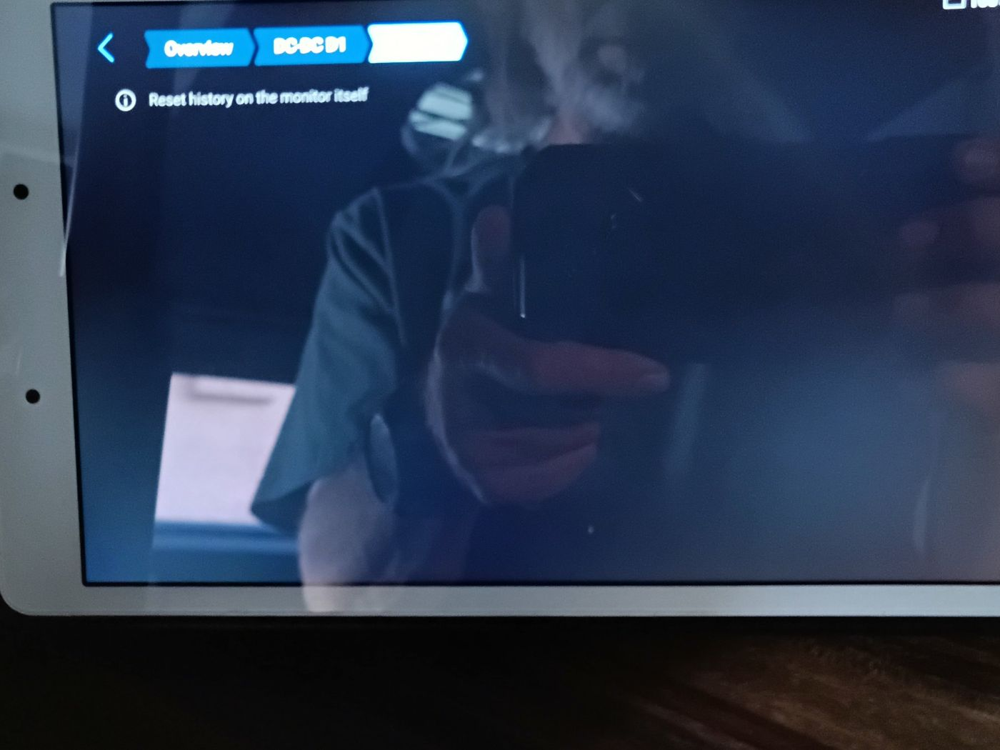
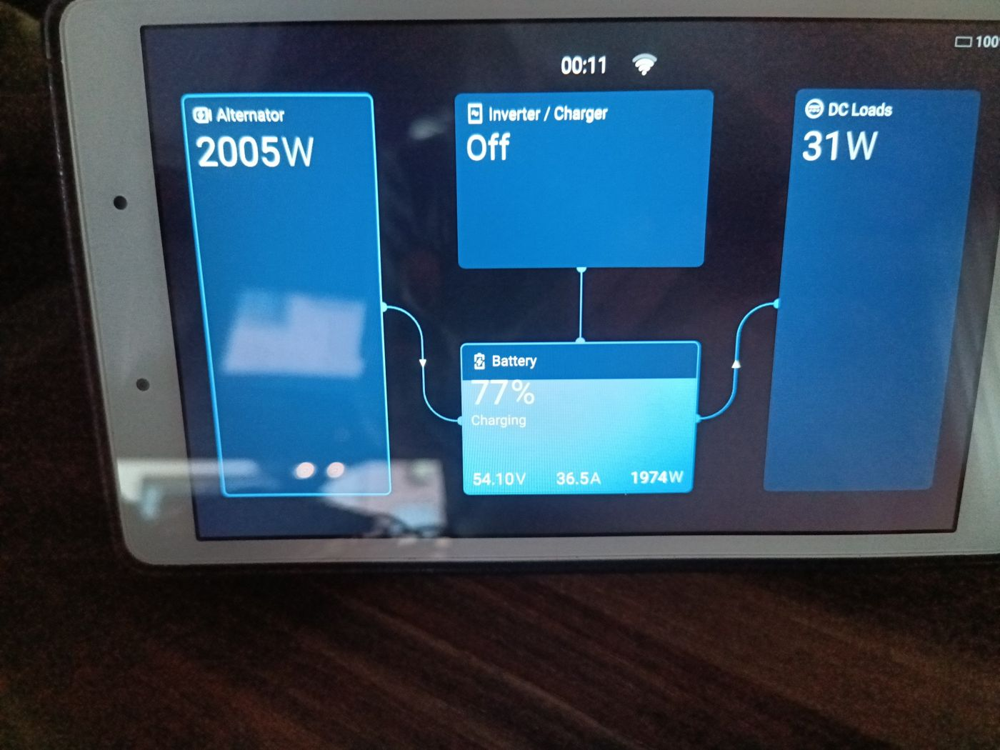
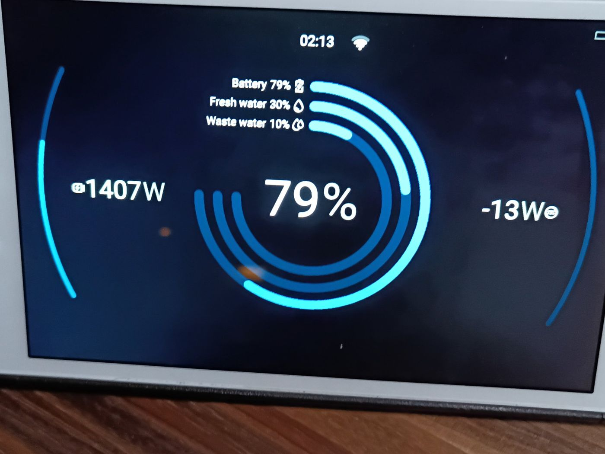
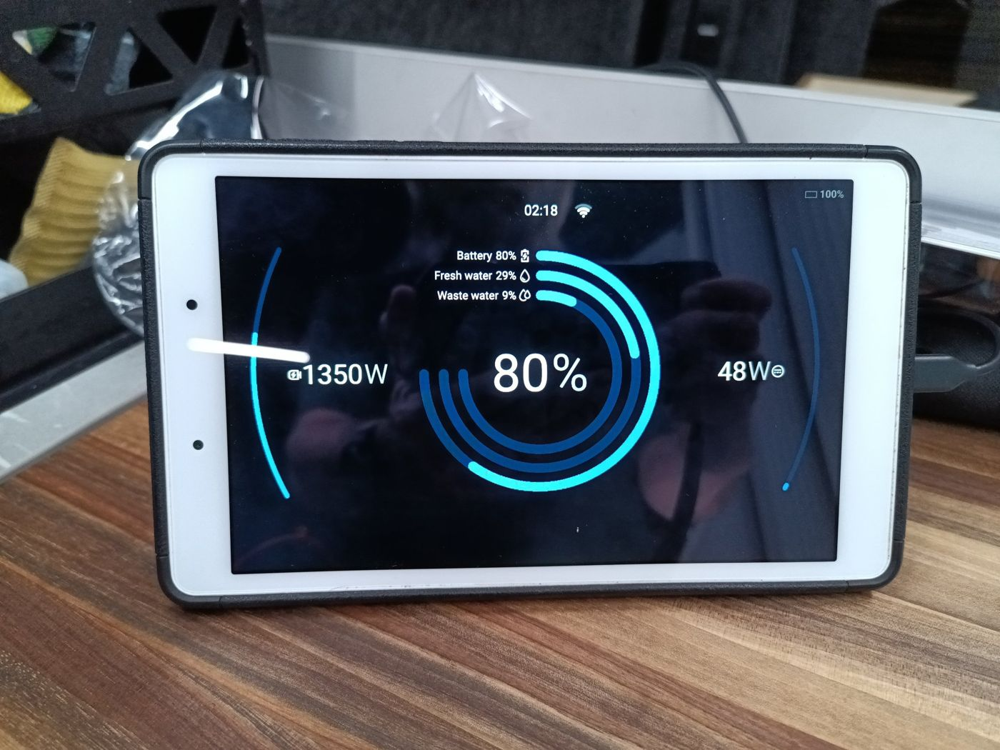
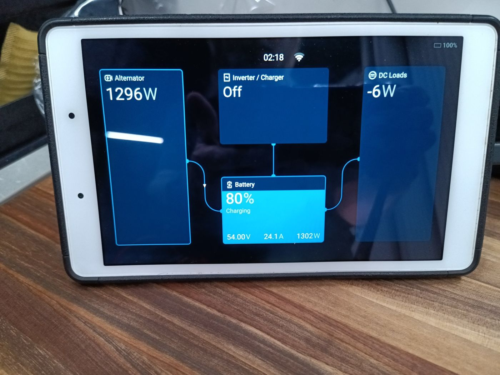
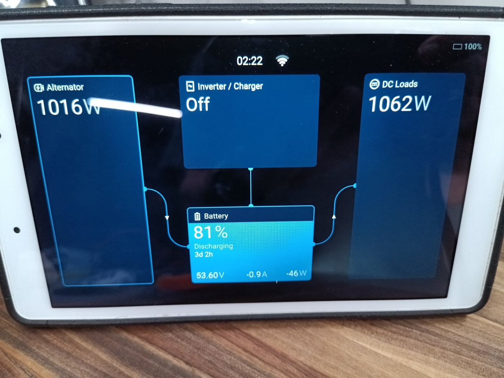
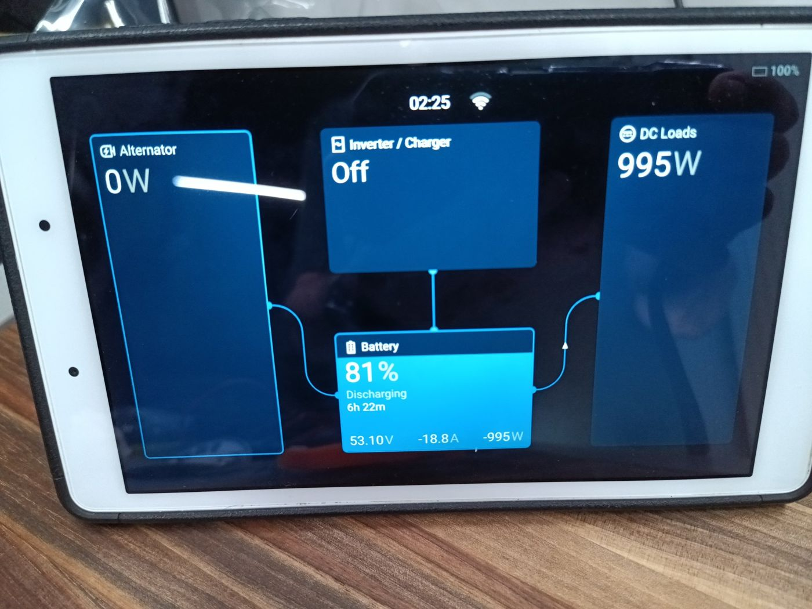
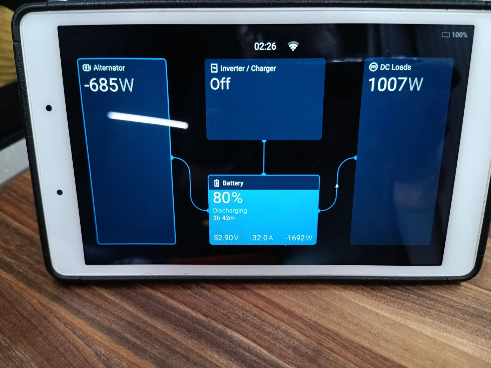

# Field test, 2026-11-07: first drive with monitor v2.5.0

In every test the Cerbo's three Overview tiles added up within a few watts. The monitor reported both
directions correctly: **boost** while driving, **buck** after the Egis relay switched.

## Setup

| Item | Detail |
| --- | --- |
| Vehicle | Grand Design LTV1 on Ford Transit, two 250 A alternators, 2/0 cable, 200 A breaker |
| Converter | Nomadic D1, alone on the Cerbo's VE.Can 2 at 500 kbit/s |
| Driver | D1 monitor v2.5.0 (monitor only; nothing is sent to the D1), shown as an Alternator |
| 48 V battery | Lithionics, on VE.Can 1 with the Firefly module |
| 12 V side | Chassis batteries, through the Egis battery relay to the rear bus bar |
| Display | Cerbo GX remote console on an Android tablet |

How to read the Overview:

- **Alternator** = power the D1 moves between 12 V and 48 V (+ charging the 48 V battery, − powering the 12 V side).
- **Battery** = the Lithionics.
- **DC Loads** = 48 V equipment with no meter of its own (mainly the A/C compressor), worked out as Alternator − Battery.

## History page

Before v2.5.0, Device list › DC-DC D1 › History showed only "Reset history on the monitor itself", because the
monitor sent live readings only. v2.5.0 adds running records kept across restarts (see [CHANGELOG](../../../CHANGELOG.md)).

24-hour checklist:

- [ ] History page fills in on the Cerbo
- [ ] Produced energy rises while driving; Consumed energy rises after the Egis switches
- [ ] Lowest 12 V voltage looks right for the chassis batteries
- [ ] Records survive a Cerbo restart
- [ ] Clear History resets everything after the test

## Display questions

- **More data on the Alternator tile?** No. Victron's software draws that tile with one number (total power).
  Changing it means patching Victron's display, which firmware updates would undo. The monitor's web page shows
  volts, amps and watts for both sides instead.
- **Watts and amps together on the Brief page?** One at a time: Settings › General › Display & Appearance ›
  Data units › Electrical power display (Watts, Amps, or Mixed = AC in watts, DC in amps).
- **What does the right side (DC Loads) show?** What the 48 V equipment uses. The Cerbo calculates it, so readings
  like −13 W or 48 W with nothing on are small meter differences; treat under ~50 W as zero.
- **Where do 12 V loads show?** On the left, as a negative Alternator reading when the D1 powers the 12 V side.

## Test 1: driving, boost charging, A/C off

The D1 charged the 48 V battery from the alternators at 1.3–2.0 kW; DC Loads stayed near zero.

| Time | Alternator | Battery | DC Loads |
| --- | --- | --- | --- |
| 00:11 | 2005 W | 54.10 V, 36.5 A, 1974 W, 77% charging | 31 W |
| 02:13 (Brief) | 1407 W | 79% | −13 W |
| 02:18 (Brief) | 1350 W | 80% | 48 W |
| 02:18 | 1296 W | 54.00 V, 24.1 A, 1302 W, 80% charging | −6 W |

## Test 2: driving with the 48 V A/C on (02:22)

The alternators carried almost all of the 1 kW A/C load through the D1; the house battery made up only 46 W.

| Alternator | Battery | DC Loads |
| --- | --- | --- |
| 1016 W | 53.60 V, −0.9 A, −46 W, 81% discharging | 1062 W |

Check: 1016 W + 46 W = 1062 W. The "3d 2h" time-to-go reflects only the 46 W net draw.

## Test 3: engine off, A/C on, before the Egis switches (02:25)

The D1 was idle and the 48 V battery carried the whole compressor; the 12 V A/C fans still ran from the chassis
batteries.

| Alternator | Battery | DC Loads |
| --- | --- | --- |
| 0 W | 53.10 V, −18.8 A, −995 W, 81%, 6h 22m left | 995 W |

## Test 4: after the Egis switches to the Lithionics (02:26)

The D1 switched to buck with no gap and powered the 12 V side from the 48 V battery; the Alternator tile went
negative as designed.

| Alternator | Battery | DC Loads |
| --- | --- | --- |
| −685 W | 52.90 V, −32.0 A, −1692 W, 80%, 3h 42m left | 1007 W |

Check: 685 W + 1007 W = 1692 W. The 685 W is measured on the 48 V side and includes D1 conversion loss.

## Findings and follow-ups

- The Cerbo's energy balance closed in all four tests (within ~50 W), so the monitor's sign and scaling are right
  in both directions.
- While driving, the D1 kept a ~1 kW A/C running almost entirely off the alternators.
- Engine off, A/C plus 12 V loads took ~1.7 kW from the Lithionics: about 3h 42m from 80%.
- [ ] 685 W on the 12 V side seems high for A/C fans alone: check what else was running on 12 V (the web page
  shows 12 V amps).
- [ ] Finish the 24-hour History checklist above.
- [ ] Brief page: try Mixed or Amps under Electrical power display if amps are preferred.
