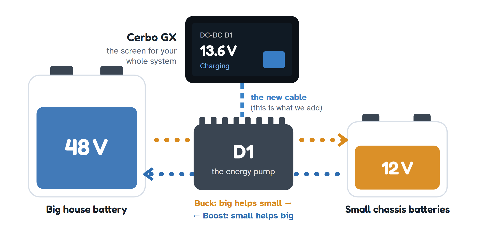
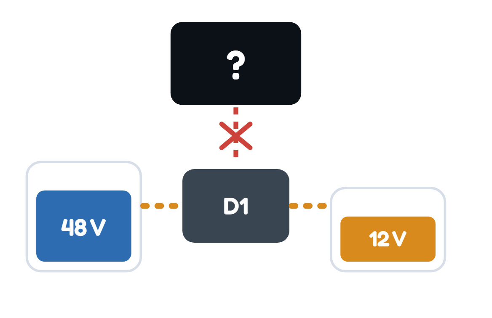
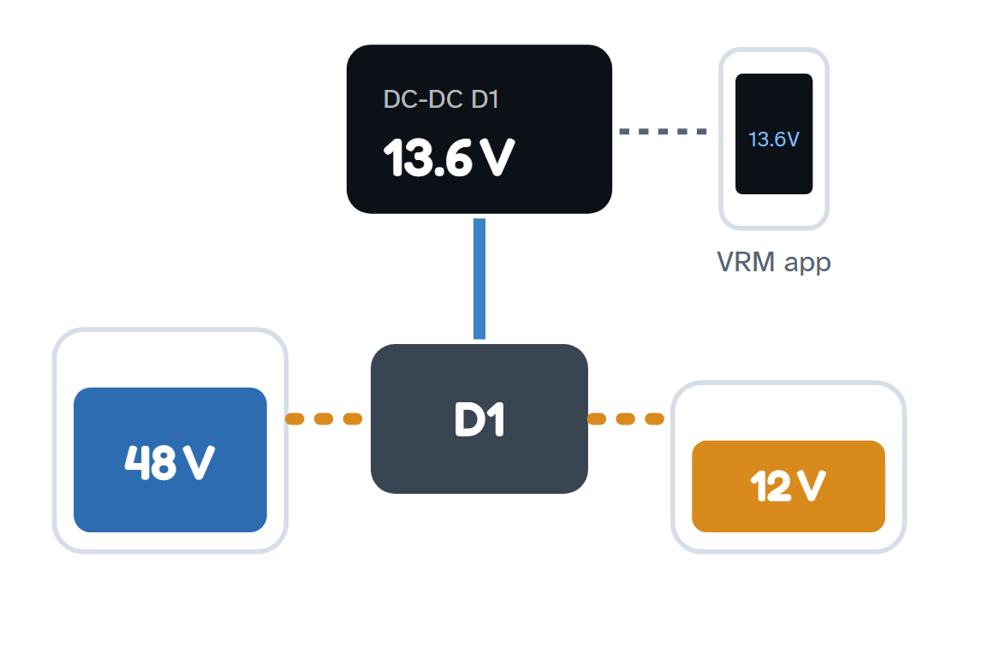
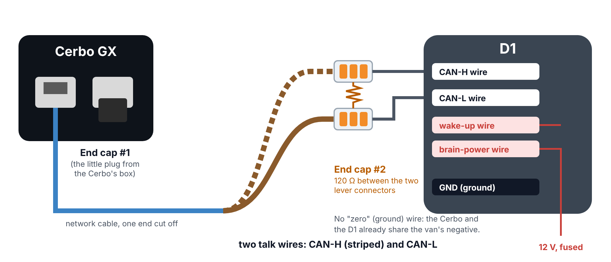
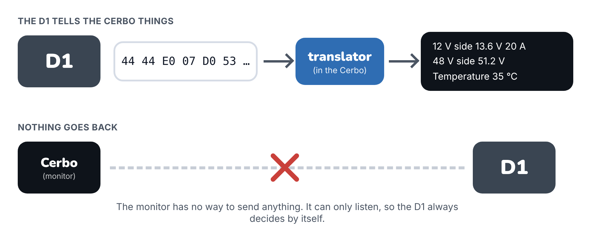
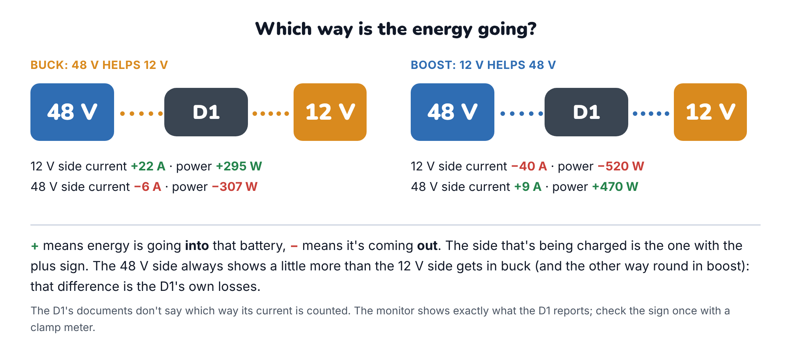
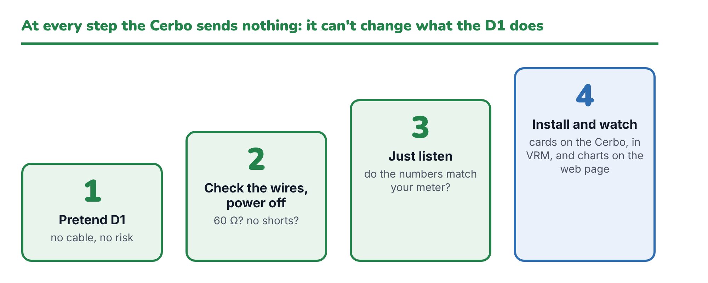

# How it works, in plain English

This page explains what this project does without assuming you know anything about electronics or
programming. For the step-by-step setup, see the [Installation Guide](installation-guide.pdf).

---

## The whole story in one picture

You have a **big battery** (48 V) and some **small batteries** (12 V). The **D1** sits between them and moves
energy from one to the other, like a pump between two water tanks:

- **Buck:** the big battery helps the small ones (48 V → 12 V).
- **Boost:** the small batteries help the big one (12 V → 48 V).

Your **Cerbo GX** is the screen for your whole power system. Right now it can't see the D1 at all.
**This project lets the Cerbo listen to the D1**, so you can see what it's doing.

## Meet the players

| | What it is | What it does |
|---|---|---|
| **Big battery** | 48 V | Your main energy store. It runs the big loads |
| **Small batteries** | 12 V | The vehicle's chassis batteries. They like about 13.5 V when charging |
| **D1** | The energy pump | Moves energy between the two. It has its own little brain and already works on its own |
| **Cerbo GX** | Victron's system screen | Shows everything, and sends it to the VRM app on your phone |
| **The cable** | A phone line | Connects the D1 to the Cerbo. You make it from a normal network cable |
| **The monitor** | A translator | A small program we install on the Cerbo. It understands the D1's language, and only listens |

## What changes

| Today | After |
|---|---|
|  |  |
| The D1 does its job on its own. Nobody can see what it's doing. | The D1 still does its job on its own, exactly as before. Now the Cerbo shows its numbers on its screen, in the VRM app and on a web page with charts. |

## The phone line (the cable)

- **Two talk wires** (CAN-H and CAN-L) carry the messages. They're twisted together like a braid, which keeps out
  electrical noise.
- **No "zero" wire.** The Cerbo and the D1 already share the van's negative, so they agree on what zero volts
  means without an extra ground wire.
- **Two lever connectors** (like WAGO 221) join the talk wires to the D1's own labelled CAN-H and CAN-L wires. No
  crimping and no opening its plug.
- **The end caps** (120 Ω resistors) stop messages bouncing back off the ends of the line, like the foam wall at
  the end of a swimming lane. There must be exactly two: one at the Cerbo (a small plug that comes in the Cerbo's
  box) and one at the D1. The D1 doesn't have one built in, so you add a resistor there: it sits between the two lever connectors.
- **The red wires** are the D1's own "brain power" (KL30) and "wake-up" (KL15). If the D1 works today, they're
  already connected.

## The translator

The D1 sends short coded messages about 130 times a second. For example, the eight numbers
`44 44 E0 07 D0 53 00 00` mean *12 V side 13.6 V and 20 A, 48 V side 51.2 V, temperature 35 °C*.
The Cerbo can't understand that by itself. The monitor translates it.

**It only works in one direction.** The monitor has no way to send the D1 anything: that part of the program
simply doesn't exist. So the D1 always decides for itself, exactly as it does today.

## Who's driving? Always the D1

The D1 watches the small batteries and decides by itself. Below 12.5 V it fills them back up (to about 13.4 V).
Between 12.5 and 13.5 V it rests. Above 13.5 V it helps the big battery. The Cerbo just watches.

## What you'll see

| On the Cerbo screen | In the VRM app |
|---|---|
|  |  |

Three cards: the converter itself (any **alarm**, what it's doing, its **temperature**), its **12 V side** and its
**48 V side** (current, power and voltage of each). When something's wrong, the alarm turns red and says what it is:

And on any phone or laptop at home, a web page with the same numbers and charts of the last day:

## Reading the numbers

The sign tells you which way the energy is going: **+** into that battery, **−** out of it. In buck the 12 V side
shows plus and the 48 V side minus; in boost it's the other way round. The two powers are never quite equal: the
difference is what the D1 itself uses (a few percent). The web page also draws an arrow showing the direction.

The D1's documents don't actually say which way it counts its current, so the monitor shows exactly what the D1
reports. Check it once with a clamp meter (it's part of the Safe Test Plan); if it's the other way round on your D1,
just read the signs the other way.

## Staying safe

Because the monitor can't send anything, it can't make the D1 do anything wrong. What protects your system is
what protected it before:

1. **The D1 protects itself.** It switches off if the 12 V side goes over 16–18 V, the 48 V side goes over
   58–60 V, the current goes over 213 A, or it gets too hot.
2. **Fuses and the battery's own protection.** Fuses guard the wires, and your 48 V battery's management system
   guards the battery.
3. **The wiring check.** The biggest real risk is a wiring mistake when you make the cable, so the plan checks the
   wires with the power off before anything is switched on.

## How it's checked: four easy steps

You only go up a step when the one you're on worked:

1. **Pretend D1:** the real monitor runs on your Cerbo against a make-believe converter. No cable, no risk.
2. **Check the wires with the power off.** About 60 Ω between the talk wires, and no shorts.
3. **Just listen.** Do the Cerbo's numbers match your meter? Which side shows plus when the D1 is working?
4. **Install and watch** for a day.

The full checklist is in the [Safe Test Plan](safe-test-plan.pdf).
